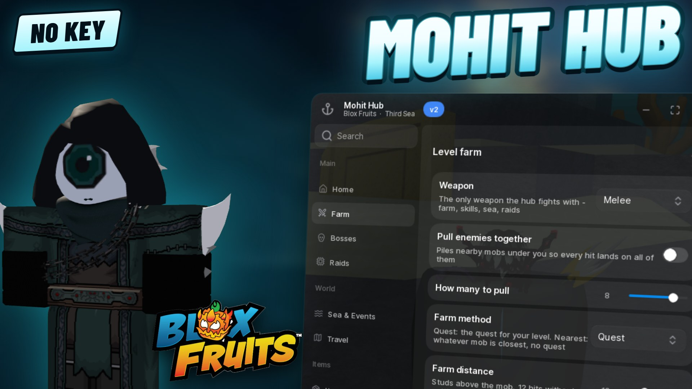

# Mohit Hub



An all-in-one hub for **Blox Fruits**. It levels you from 1 to max, kills the
bosses and raid bosses, runs the sea events, crafts and buys for you, and keeps
working after the game moves you to another server. It works in all three seas.

## Run it

```lua
loadstring(game:HttpGet("https://raw.githubusercontent.com/robomohit/MohitHub/main/mohithub.lua"))()
```

Paste that into your executor while you're in Blox Fruits. Open or hide the
window with **Right Ctrl**, or change the key in Settings.

Your settings are saved. Turn on **Load Mohit Hub after a teleport** in
Settings, and whenever the game moves you to a new server, the hub picks your
team again and loads itself.

## What it does

**Farm**
- **Auto farm:** takes the best quest for your level and farms it, from level 1
  to max. You can also farm whatever mob is closest instead.
- **Pull enemies together**, farm distance, attack speed, and which side of
  the mob to stand on.
- **Skills while farming:** pick the keys (Z X C V F), with a pause between
  skills.
- **Mastery:** your main weapon brings mobs down and the weapon you're training
  finishes them.
- **Materials** (Scrap Metal, Bones, Conjured Cocoa and others) up to a target
  count. **Bones**, with Random Surprise, Pray and Try Luck at the gravestone.

**Bosses**
- Any boss on the island list, or all of them in turn. Boss quests included.
- **Cake Prince and Dough King:** farms the kills, opens the portal, and for
  the Dough King hunts a God's Chalice and crafts the Sweet Chalice.
- **Tyrant of the Skies:** lights the four Tiki eyes, breaks the urns and
  kills it.
- **Pirate raid** at the Castle on the Sea, by hand or whenever it's announced.
  The Law raid (Order), the Rainbow Haki quest and the Dark Blade V2 steps.

**Raids**
- Fruit raids from start to finish, including getting the chip, repeated
  until a fragments cap you set. **Awaken** your fruit afterwards.
- The dojo belt quests and the dungeon.

**Sea & Events**
- Hunts sea beasts and enemy ships from your own boat, and dodges the sea
  beasts' attacks.
- **Mirage Island:** sails until it spawns, then takes you to the blue gear.
- **Kitsune Island:** starts the shrine at full moon, collects the Azure
  Embers and trades them.
- **Prehistoric Island**, from the Volcanic Magnet to the end of the event.
- Faster boat and walk on water.

**Travel:** any island or NPC in your sea, picked from a searchable list.

**Items**
- **Chests:** collects every chest in the server, then waits for more.
- **Fruits:** collects fruits on the map and stores them, alerts you when a
  fruit drops in your server, and rolls the fruit gacha each time it's ready.
  Shows the **fruit dealer's** stock and buys from it.
- Redeems every working code. **Fishing.**

**Shop & craft:** fighting styles (switching to one you already own is free),
the melee upgrade chains, abilities, haki colours, the legendary sword in your
server, and scroll crafting.

**Quests:** Rengoku, True Triple Katana, Tushita, the sea unlock quests and
Race V4.

**Stats:** spends your points on up to three stats at once.

**Visuals:** ESP, black screen, hide damage numbers, unlimited zoom, and
spectate or fly to a player.

**Settings:** walk speed, jump power, auto haki, remove fog, Discord alerts
for events and mythical fruits, and a stop-everything button.

## What it won't do

It doesn't teleport across the map: it flies at a normal speed, because an
instant jump gets you kicked. It never hops servers by itself, never attacks
other players, and never spends Robux.

## Crash reports

If Mohit Hub hits an error, it sends a short crash report so the bug can be
fixed. The report holds the error message, your executor's name, phone or PC,
screen size, the game's place ID and the Mohit Hub build. It never holds your
username, account data or anything about your items, and your name and ID are
removed from the error text before it's sent. At most five reports are sent a
session, and never the same one twice. If the hub can't start at all, you'll
see the reason in a Roblox notification.

## Notes

Automating a Roblox game can get the account banned. Use an account you can
afford to lose.

The published script is obfuscated with Prometheus.
Based on Prometheus by Elias Oelschner, https://github.com/prometheus-lua/Prometheus

## Source

Not published. This repository carries the built script only.
